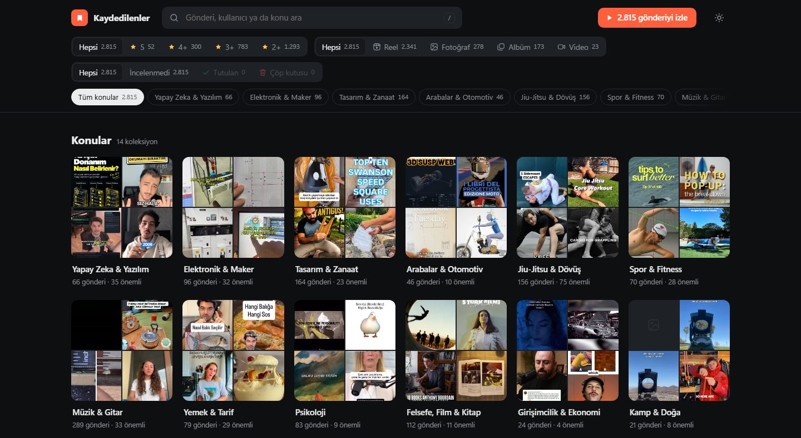
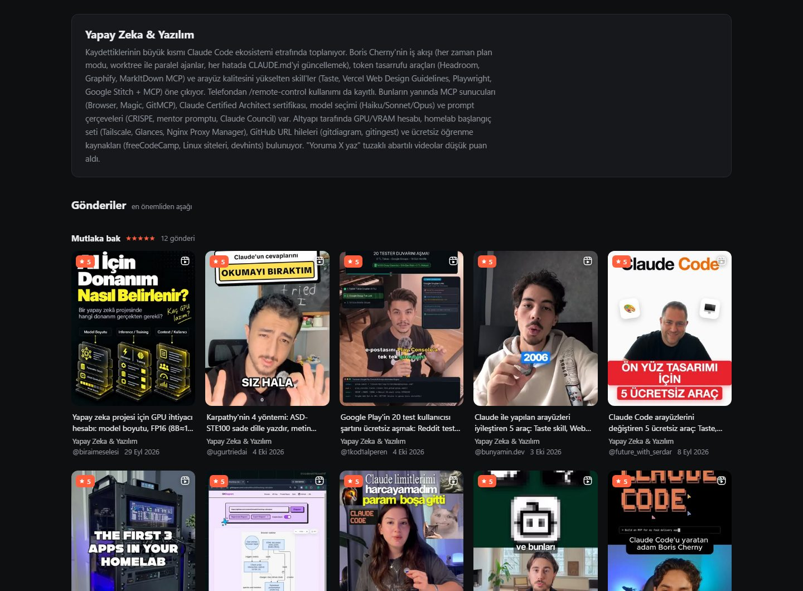
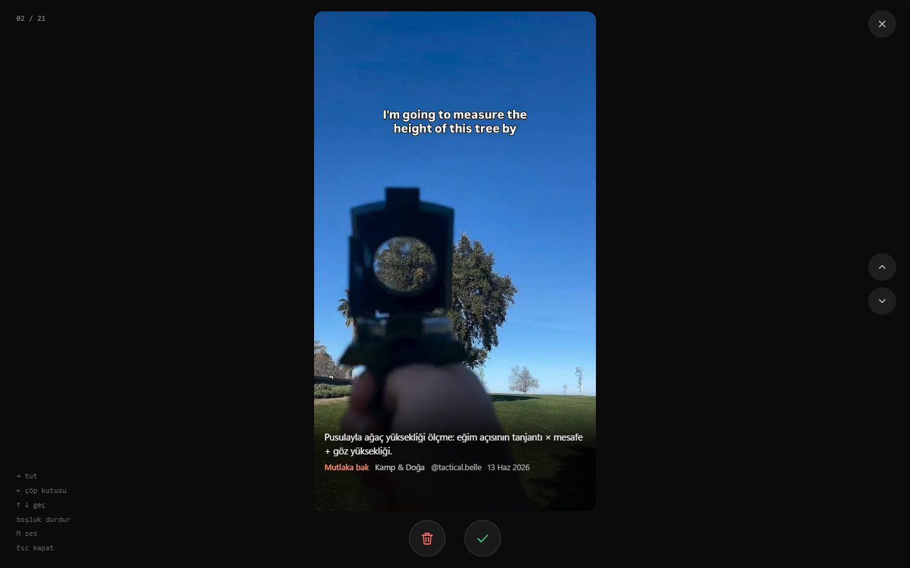

[Türkçe](README.md) · **English**

# Kaydedilenler: organize your Instagram saved posts with Claude and ChatGPT


Exports everything you've saved on Instagram, uses AI (Claude or ChatGPT) to sort it into topics, writes a short summary for each post and ranks them by importance. Then you review them Reels-style: **swipe right to keep, swipe left to trash**. Everything runs on your own computer.

> **Language note:** the interface, the topic names and the summaries are currently in Turkish ("Kaydedilenler" means "Saved"). The prompts in [PROMPTLAR.md](PROMPTLAR.md) are Turkish too, but any modern model understands them; add "answer in English" if you prefer English topics and summaries.



| List filtered by topic and importance | Watching and sorting |
|---|---|
|  |  |

## Features

- **Topics**: your saved posts are grouped into 10–15 topics, each with a summary and an Instagram-collection-style mosaic cover.
- **Importance ranking**: every post gets a 1–5 score and a one or two sentence summary. The list runs from "must see" (Mutlaka bak) down to "humor" (Mizah).
- **Filters**: search, importance, type (Reel / Photo / Album / Video), topic and status. Counts update with your other filters.
- **Watch mode**: a vertical, Reels-like feed with autoplay.
  - Drag right (or press →): the post stays.
  - Drag left (or press ←): the post goes to the **trash**.
  - After every decision an "Undo" (Geri al) button appears for a few seconds.
- **Trash**: sorted-out posts aren't deleted; they wait in a separate view and can be restored any time.
- Dark and light themes, works on phones. Filtered views can be bookmarked from the address bar: `#konu=…&onem=4&izle`.

## Setup (Windows, one click)

1. On this page click **Code → Download ZIP** and extract it to a folder. `git clone` works too.
2. Double-click **`baslat.bat`** ("start"). It installs Python if missing, downloads what it needs and tells you what to do step by step:

   | Step | What happens |
   |---|---|
   | **1. Export** | Instagram opens and the export script is copied to your clipboard. **F12 → Console → Ctrl+V → Enter**. About 1000 posts take 2–3 minutes. When done, `saved.json` downloads. |
   | **2. Analyze** | Run `baslat.bat` again. It picks up the downloaded file and asks for your [Claude API key](https://console.anthropic.com/settings/keys). It proposes topics, and after you approve them it analyzes everything. |
   | **3. Watch** | The report opens in your browser. It works as long as the black window stays open. |

After that, `baslat.bat` is all you need. To add newly saved posts, repeat step 1; only the new posts are analyzed.

**Cost:** analysis uses Claude Opus 5.5. 1000 posts cost roughly **$4–5**, paid once. It shows an estimate before starting and the actual spend at the end.

**No API key?** Use the AI subscription you already have (see the table below). If you leave the key empty the report still opens; topics and summaries appear once the analysis is added.

## Which AI can I use?

| You use | Exporting saved posts | Analysis (topic, score, summary) |
|---|---|---|
| a **Claude API** key | console script (`baslat.bat` opens it) | **automatic**: `baslat.bat` asks for the key and does the rest |
| **Claude Code**, **Codex CLI**, **Cursor**, **Gemini CLI** | console script | [ready-made prompt](PROMPTLAR.md) in the project folder; rules are read from `AGENTS.md` |
| **ChatGPT**, **Gemini**, **Claude.ai** (web) | console script | upload `compact.jsonl` to the chat and get the analysis files with the [ready-made prompt](PROMPTLAR.md) |
| **Claude in Chrome** | Claude exports with the [ready-made prompt](PROMPTLAR.md) | one of the above |

Exporting needs no AI at all: `baslat.bat` copies the script to your clipboard and you paste it into the browser console.

<details>
<summary>macOS / Linux</summary>

Put `saved.json` into the `data/` folder yourself, then:

```bash
python3 -m venv .venv && .venv/bin/pip install -r requirements.txt
.venv/bin/python analiz.py && .venv/bin/python build.py && .venv/bin/python izle.py
```
</details>

## Optional: transcribing video audio

Summaries normally come from the post caption. For talking or tutorial videos, a transcript gives better summaries and scores. An NVIDIA GPU is recommended.

```bat
.venv\Scripts\pip install -r requirements-transkript.txt
.venv\Scripts\python transcribe.py
```

Without a GPU, run `transcribe.py --device cpu --model small`. Run it right after exporting, because the audio links expire after about a day. Then run `baslat.bat`.

## Ready-made prompts

[PROMPTLAR.md](PROMPTLAR.md) contains four prompts:

- Exporting saved posts with **Claude in Chrome**.
- Running the analysis with **Claude Code / Codex / Cursor / Gemini CLI** (no API key).
- Running the analysis in a **ChatGPT / Gemini / Claude.ai** web chat.
- **Fixing topics** afterwards, e.g. moving the camping videos out of "Other" (Diğer) into a new topic by looking at their cover images.

## On your own server (optional)

To open it from your phone or anywhere, the [`sunucu/`](sunucu) ("server") folder has a Docker and key-protected Caddy example. Keep/trash decisions are stored on the server, so every device sees the same list.

## Privacy

- Your saved posts, analyses, covers, decisions and the report stay only in the `data/` folder and `rapor.html` on your computer. Both are in `.gitignore`.
- The export script only reads; it changes nothing on Instagram. Pages are requested 3–5 seconds apart. Your password and session are never written to any file.
- The trash only affects this list; your saved posts on Instagram are not removed.
- For analysis, post captions (and transcripts, if any) are sent to the AI you choose: the Claude API or your assistant.
- It uses Instagram's unofficial web endpoints. If Instagram changes something, exporting may break. Use it on your own account, at your own risk.

## How it works

| File | Role |
|---|---|
| `scrape.js` | runs in the instagram.com console, reads saved posts page by page → `saved.json` |
| `analiz.py` | Claude API: topics, score, summary → `data/analiz/*.tsv`, topic summaries → `data/analysis.json` |
| `transcribe.py` | optional: transcribes video audio with faster-whisper |
| `build.py` | builds a single-file report → `rapor.html` |
| `izle.py` | serves the report on `127.0.0.1:8765`; fetches videos and covers from Instagram on demand, stores decisions |
| `baslat.bat` | runs everything in order |
| `AGENTS.md` | project rules and data format for Claude Code, Codex, Cursor, Gemini CLI |

The report and the local server use only the Python standard library; the only extra package is `anthropic`.
